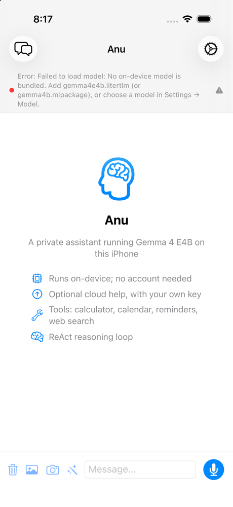
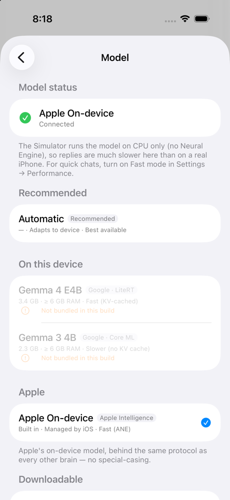
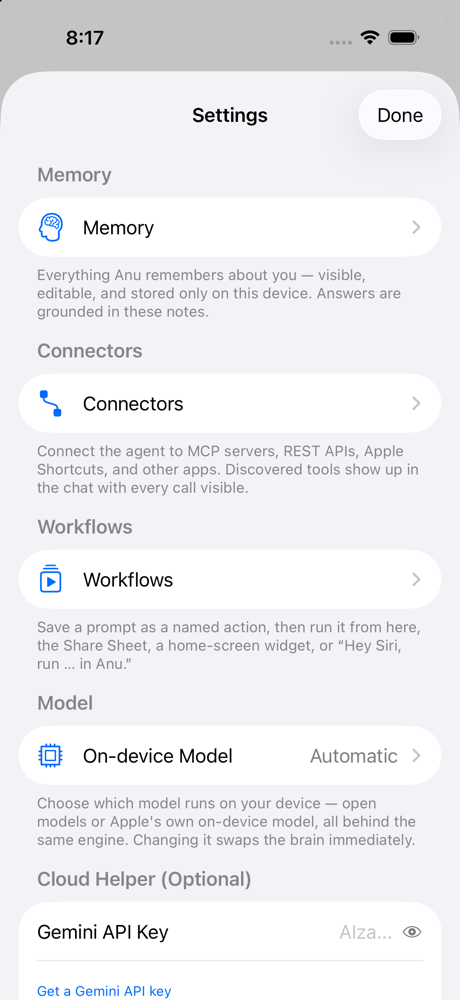

# Anu — On-Device Agentic AI for iOS

[](https://github.com/sandeepvijayarao09/Anu-iOS/actions/workflows/ci.yml)
[](LICENSE)


Anu is an assistant for iPhone whose brain is **Gemma 4 running on the
device** through Google's LiteRT-LM runtime. It answers, uses tools, remembers
what you tell it, and asks before it does anything other people will see. The
cloud is optional: a sanitised hand-off to Gemini, to a server you run, or to
your own Mac, and every byte that leaves the phone is listed in a ledger.

> **Status:** builds and runs on iOS 17+ (simulator and device) and macOS 15+.
> 902 unit tests and 30 UI tests pass by default (12 of them skip unless opted in) on the iPhone 17 Pro
> simulator (measured 2026-11-13); more are gated behind opt-in flags
> ([ARCHITECTURE.md §14](ARCHITECTURE.md#14-testing)).

---

## What it does

- **On-device brain.** Gemma 4 E4B (bundled) or E2B/E4B (downloaded), with an
  8,192-token context. A **Direct tier** runs single phone commands
  ("set a timer for 5 minutes") with no model at all.
- **Routing.** An on-device classifier picks chat, the agent loop, a
  multi-step planner (Deep reasoning) or the cloud. `ToolSelector` fits the
  right tools into the prompt; `DeviceGuard` scales back when the phone is hot
  or the battery is low.
- **A trust core.** Every tool call goes through the **Tool Broker**: schema
  check, risk tier, taint from untrusted content, replay protection, and an
  approval sheet showing the exact payload (with Edit) for anything that
  leaves Anu. Receipts under each answer list what really happened, and
  **About this answer** shows where your data went, which model answered and
  how fast.
- **Vault.** API keys and tokens are stored in the Keychain, each bound to its
  own host, and attached to requests only by the vault. Values show only after
  Face ID. On-device stores are encrypted with `SecureFile`.
- **Memory.** Facts with their sources, learned on device while the phone is
  idle, never sent to the cloud. The Memory Inspector lets you search,
  confirm, correct and delete them.
- **Skills.** `SKILL.md` skills with JavaScript run in a sandbox with no
  network. Four ship built in; you can add your own from a file or URL.
- **Connectors.** MCP servers (catalog, registry, OAuth), REST APIs, UCP
  storefronts, Gmail, A2A agents on your network, your Mac (Ollama), Apple
  Shortcuts and other apps.
- **Voice and media.** Live voice mode with barge-in and "Hey Anu", voice
  notes transcribed on device, up to 4 photos and a PDF per message, image
  generation with Image Playground, live camera.
- **Everywhere else.** A home-screen widget for workflows, a share extension,
  "Rewrite with Anu" and the **Anu Keyboard** (Apple's on-device model, with a
  hand-off to Gemma in the app), Siri and Shortcuts (10 App Shortcuts),
  scheduled workflows.
- **Privacy Ledger and Activity.** Every egress with its payload and what was
  redacted; every action taken or blocked.

How it all fits together: **[ARCHITECTURE.md](ARCHITECTURE.md)**.

---

## Screenshots

| Home | Models | Settings |
|---|---|---|
|  |  |  |

These were taken before the features listed above were added; the app has more screens now.

## Build and run

No CocoaPods and no workspace. The Xcode project is generated by
`generate_xcodeproj.py`; Swift packages (MCP, and LiteRT-LM vendored in
`ThirdParty/LiteRTLM`) resolve on first build.

### 1. Get the model (optional for the Simulator)

The model is git-ignored (3.4 GB). Without it the app still builds; you can
download Gemma 4 E2B or E4B in Settings → Model instead.

```bash
pip install huggingface-hub
python3 - <<'PY'
from huggingface_hub import hf_hub_download
import shutil
p = hf_hub_download("litert-community/gemma-4-E4B-it-litert-lm", "gemma-4-E4B-it.litertlm")
shutil.copy(p, "Anu/gemma4e4b.litertlm")
PY
```

### 2. Generate the project

```bash
python3 generate_xcodeproj.py
# for a device build, with your own team and bundle IDs:
ANU_TEAM_ID=ABCDE12345 ANU_BUNDLE_PREFIX=com.example.anu python3 generate_xcodeproj.py
```

Re-run it after adding any file: the file lists are explicit, not globbed.
`ANU_BUNDLE_PREFIX` sets every target's bundle ID and the App Group
(`group.<prefix>`).

### 3. Open and run

```bash
open Anu.xcodeproj
```

Run the `Anu` scheme on a recent iPhone for usable speed (the Simulator runs
the model on the CPU). The `AnuMac` scheme builds the macOS app. Optional:
add a Gemini key, a private compute server or your Mac in Settings.

---

## Testing

```bash
xcrun simctl create anu-tests "iPhone 17 Pro"
xcodebuild test -project Anu.xcodeproj -scheme Anu \
  -destination 'platform=iOS Simulator,id=<UDID>' \
  -only-testing:AnuTests \
  -skip-testing:AnuTests/ContactsIntegrationTests \
  -skip-testing:AnuTests/EventKitIntegrationTests \
  -skip-testing:AnuTests/PhotosIntegrationTests \
  CODE_SIGN_IDENTITY=- CODE_SIGN_STYLE=Manual DEVELOPMENT_TEAM=
# UI tests: the same with -only-testing:AnuUITests
```

Sign ad hoc as shown: an unsigned build has no Keychain, so vault tests fail.
UI tests run against a DEBUG-only scripted model (`-scripted_model YES`), so
they're deterministic and need no model file. Real-engine, live-network and
heavier GUI tests are opt-in through `TEST_RUNNER_*` flags; see
[ARCHITECTURE.md §14](ARCHITECTURE.md#14-testing).

---

## Documentation

- [ARCHITECTURE.md](ARCHITECTURE.md): the design, as built
- [Docs/GMAIL_SETUP.md](Docs/GMAIL_SETUP.md), [Docs/MacBrain.md](Docs/MacBrain.md),
  [Docs/PrivateComputeServer.md](Docs/PrivateComputeServer.md): optional services
- [Docs/DEVICE_TEST_CHECKLIST.md](Docs/DEVICE_TEST_CHECKLIST.md): what needs a real iPhone
- [CONTRIBUTING.md](CONTRIBUTING.md), [SECURITY.md](SECURITY.md)

The model is Google's unchanged Gemma 4 weights; the engineering is in the
harness around it.
